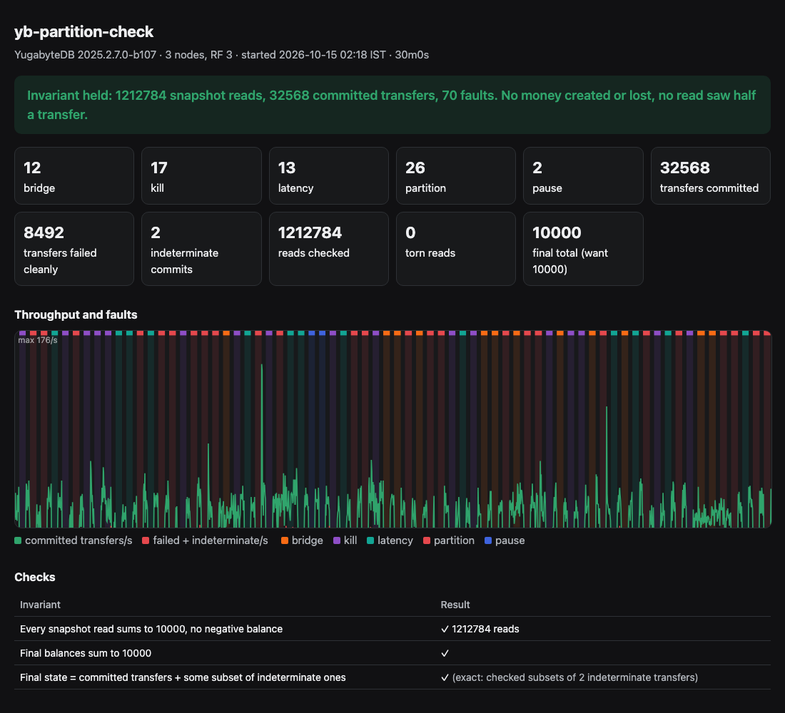

**38 network partitions (12 of them non-transitive), 17 SIGKILLed nodes, 13 latency injections and 2 frozen nodes over 30 minutes on a 3-node YugabyteDB 2025.2 cluster. The bank invariant held throughout: 32,568 committed SERIALIZABLE transfers, 1,212,784 snapshot reads, zero torn reads, and the final total exact to the unit.**

# yb-partition-check

A Jepsen-style correctness harness for [YugabyteDB](https://github.com/yugabyte/yugabyte-db). It runs a bank-transfer workload against a real 3-node cluster while breaking the network and the nodes underneath it, then checks that no money was created or lost and that no reader ever saw half a transfer.

Upstream contribution made while building this: [yugabyte/yugabyte-db#35101](https://github.com/yugabyte/yugabyte-db/pull/35101) (docs: Wait-on-Conflict is the default, but the concurrency-control page said it had to be enabled).



## What it does

| Part | How |
|---|---|
| **Cluster** | 3 × `yugabyted` in Docker Compose, one node per zone, replication factor 3, `--fault_tolerance=zone`. |
| **Workload** | 10 accounts × 1,000. 8 writers run `SERIALIZABLE` transfers (lock both rows in id order, check funds, move 1-50). 2 readers take `REPEATABLE READ` snapshots of every balance. Each client sticks to one node and moves to the next when its connection breaks. |
| **Faults** | Every 10 s a random fault runs for 15 s. **Partition**: one node cut off from the other two (majority/minority). **Bridge**: a non-transitive partition, where A and B can't talk but both still reach C. **Kill**: `SIGKILL`, then restart. **Pause**: the container is frozen. **Latency**: 150 ms ± 50 ms of `netem` delay. |
| **History** | Every operation is recorded with its start, end, node and outcome. A `COMMIT` that fails with a server error counts as failed. One cut off by a timeout or a dropped connection is **indeterminate**: it may or may not have committed. |
| **Checker** | Three checks. (1) Every snapshot read sums to 10,000, with no negative balance. (2) The final balances sum to 10,000. (3) The final state equals the committed transfers plus some subset of the indeterminate ones. That means no acknowledged transfer was lost and no failed one took effect. It searches every subset when there are 20 or fewer indeterminate transfers, and checks per-account bounds otherwise. |
| **Report** | A self-contained HTML page per run: verdict, fault timeline over throughput, the checks, every fault, and the errors clients saw (`results/*.html`, with JSON alongside). |

Network faults run `iptables`/`tc` from a throwaway container that joins the target node's network namespace (`docker run --net container:yb1 --cap-add NET_ADMIN`). The database image is not modified and gets no extra privileges.

## Results

| Run | Faults | Committed transfers | Reads checked | Torn reads | Indeterminate | Final total |
|---|---|---:|---:|---:|---:|---|
| 30 min | 26 partitions, 12 bridges, 17 kills, 2 pauses, 13 latency | 32,568 | 1,212,784 | 0 | 2 (explained) | 10,000 ✓ |
| 10 min | 5 partitions, 1 bridge, 8 kills, 6 pauses, 3 latency | 9,603 | 490,322 | 0 | 0 | 10,000 ✓ |

Both reports are in [`results/`](results/). No anomaly was found: YugabyteDB kept serializable transfers and snapshot reads consistent through every fault this harness could inject.

What the clients saw is worth noting:

- **Throughput drops during most faults.** A transfer touches two tablets plus a transaction status tablet. If any of their leaders is on the faulty node, the transfer waits for re-election (about 3 s with default heartbeats), and an op that waits more than 5 s times out on the client. Availability recovers as soon as leadership moves. The chart shows it.
- **`40P01 deadlock detected` came up often: 6,837 of 41,060 transfer attempts in the 30-minute run, 451 in a fault-free minute.** That happened even though every transfer locks its two rows in a single global order (lower id first), which can't form a lock cycle. All of them were clean aborts the client could retry, and none affected correctness. Under heavy contention on a few rows, the distributed deadlock detector seems to abort waiters that are not actually in a cycle. A focused reproducer for the YugabyteDB team would be a good next step.

## Run it

```bash
make demo          # cluster up, 10-minute run, report in results/latest.html
make demo-quick    # 3 minutes
make baseline      # same workload, no faults
make down          # remove the cluster
go run ./cmd/ybcheck -h   # duration, fault length, accounts, writers, readers, ...
```

Needs Docker (Compose v2) and Go. The cluster publishes YSQL on 5433-5435 and the yb-master UI on 7000.

## Layout

| Path | |
|---|---|
| `docker-compose.yml` | The 3-node cluster |
| `faultbox/` | Alpine with `iptables` and `iproute2`, used inside each node's network namespace |
| `internal/workload` | Transfers, snapshot reads, the operation history |
| `internal/nemesis` | Partitions, bridges, kills, pauses, latency, healing |
| `internal/checker` | The three invariants, including the indeterminate-subset search (with tests) |
| `internal/report` | HTML report |
| `cmd/ybcheck` | Runs it all |

## Limits

- Faults are one at a time and each is healed before the next starts. Overlapping faults, clock skew and disk faults (corruption, a full disk) would be the next nemeses.
- Partitions are at the IP layer between nodes; client-to-node traffic is left alone, except that a frozen or killed node stops answering its clients.
- The checker verifies the bank invariant, not full serializability of the history. An Elle-style cycle check over a list-append workload would be the stronger test.
